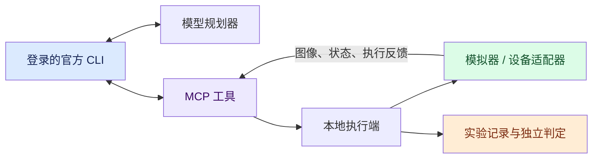

<div align="center">

# 🌉 RoboPilot Bridge

**用已登录的 Codex、Antigravity 和 Cursor，给你的机器人 harness 接上模型规划器。**

🟦 Codex · 🟪 Antigravity · 🟧 Cursor　｜　🐍 Python 3.11+　｜　🧪 可运行的模拟实验

[五分钟起步](#五分钟起步)　·　[三条接入路线](docs/providers.md)　·　[迁移到自己的机器人](docs/embodiments.md)　·　[给 Agent 的入口](AGENTS.md)　·　[English](README.en.md)

</div>

把同一个任务交给三个客户端：在一条四格轨道上，把红色物体移到绿色目标并松开。客户端用自己登录的账号选择模型，模型读取观测、调用工具，模拟器逐步执行并保存记录。只要换掉工具背后的执行端，同样的会话设计也能用在机械臂、人形机器人、灵巧手或仿真平台上。

| 🧭 我想做什么 | 从哪里开始 |
|---|---|
| 🟢 先确认本地工具链能跑通 | [离线实验](#五分钟起步) |
| 🔵 用自己的订阅跑一次模型闭环 | [登录、选模型、启动](docs/providers.md) |
| 🟣 给已有 harness 替换规划器 | [观测、动作与评审的接口](docs/embodiments.md) |
| 🟠 查为什么模型连得上却很慢 | [读图、断流与耗时诊断](docs/field-notes.md) |

### 五分钟起步

需要 Python 3.11 或更高版本。模拟器只用标准库，离线测试无需登录。

```sh
git clone https://github.com/zhuqinfeng1999/robopilot-bridge.git
cd robopilot-bridge
python -m unittest -v
```

离线测试会启动 MCP 子进程。下图是模拟器实际生成的三个观测帧：蓝条是夹爪，红点是物体，绿条是目标。测试最后检查物体是否落在目标格、夹爪是否已松开。预期输出包含 `"episode_success": true` 和 `OK`。

| ① 观测起点 | ② 抓住物体 | ③ 目标处释放 |
|:---:|:---:|:---:|
|  |  |  |

### 让订阅客户端接管

先在本机通过相应**官方 CLI 的账号登录**，选一个该账号实际可用的模型。以下三条任选一条，将 `MODEL_ID` 换成客户端显示的模型 ID。命令会使用订阅配额。程序、账号是否有权使用某个模型，以及套餐用量，以提供方当前显示为准。

```sh
python run_client.py codex       --model MODEL_ID
python run_client.py antigravity --model MODEL_ID
python run_client.py cursor      --model MODEL_ID
```

程序会输出独立运行目录。模型应当通过 `observe → act → … → finish` 完成任务。运行后用 `python pilot.py check runs/<本轮目录名>` 复核结果。若 CLI 需要交互登录、批准模拟工具或识别工程配置，使用[交互式接入步骤](docs/providers.md)。**建议从离线测试开始，本仓库公开示例的验证范围见[验证说明](docs/validation.md)。**

### 给你正在使用的开发 Agent

把下面这段发给你的开发 Agent，即可从仓库开始接入：

> 先读 AGENTS.md 和 docs/providers.md。运行离线模拟测试，确认本机 CLI 的登录方式和可选模型，由我选择一个订阅客户端。在新目录运行一轮模拟，核对客户端结束事件、工具日志和物体最终状态。然后阅读 docs/embodiments.md，给我的机器人提出观测和技能接口，并说明哪些能力还需在我的设备上验证。



本项目从桌面机械臂实验的接入经验中提炼，由新的四格模拟器演示。人形与灵巧手章节提供移植设计。仓库中的 CLI 登录、MCP 和 ACP 名称属于各自项目。本项目是独立的研究工具。
