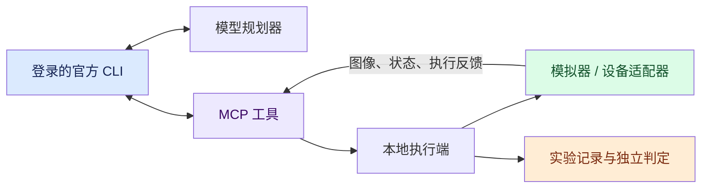

# 🌉 RoboPilot Bridge

用已登录的 **Codex、Google Antigravity 或 Cursor** 给机器人接上模型规划器。先让模型在模拟器里完成一次抓放，再把同一套工具接口接到你的人形机器人、机械臂或灵巧手上。

[中文提示词](#把这段-prompt-给你的-ai-agent) · [English prompt ↓](#give-this-prompt-to-your-ai-agent) · [English README](README.en.md)

## 把这段 Prompt 给你的 AI Agent

复制整个代码块，发给能在你电脑上执行命令的编程 Agent。仓库地址已经写在里面。离线测试免费，最后一轮模型模拟会使用所选客户端的订阅额度。

```text
请在我的电脑上搭好 RoboPilot Bridge，并用我已登录的订阅客户端跑通一次模拟抓放。
仓库：https://github.com/zhuqinfeng1999/robopilot-bridge

1. 如果当前目录已经是这个仓库就复用，否则克隆到新的子目录。读 AGENTS.md 和 docs/providers.md，用 Python 3.11+ 在仓库根目录运行 python -m unittest -v。
2. 检查本机的 Codex、Antigravity 和 Cursor 官方 CLI。优先用我指定的客户端；如果只有一个已登录就用它，有多个就让我选。通过官方客户端确认账号可用的模型。需要登录或授权时让我在官方界面操作，凭据留在客户端。
3. 用选定的客户端和实际模型 ID 运行 run_client.py，将 rail MCP 接到模拟器，只跑一轮。若需要批准工具，按文档的交互方式完成同一个模拟任务。此次搭建只使用模拟器。
4. 核对客户端结束事件，并对实际运行目录执行 python pilot.py check。确认返回 "episode_success": true，再告诉我所用客户端和模型、运行目录，以及我下次可以直接复制的启动命令。如果卡住，指出失败的步骤和具体原因。
```

### 这个 Bridge 怎么工作



把同一个任务交给三个客户端：在一条四格轨道上，把红色物体移到绿色目标并松开。客户端用自己登录的账号选择模型，模型读取观测、调用工具，模拟器逐步执行并保存记录。只要换掉工具背后的执行端，同样的会话设计也能用在机械臂、人形机器人、灵巧手或仿真平台上。

| 🧭 我想做什么 | 从哪里开始 |
|---|---|
| 🟢 先确认本地工具链能跑通 | [离线实验](#五分钟起步) |
| 🔵 用自己的订阅跑一次模型闭环 | [登录、选模型、启动](docs/providers.md) |
| 🟣 给已有 harness 替换规划器 | [观测、动作与评审的接口](docs/embodiments.md) |
| 🟠 查为什么模型连得上却很慢 | [读图、断流与耗时诊断](docs/field-notes.md) |

### 五分钟起步

需要 Python 3.11 或更高版本。模拟器只用标准库，离线测试无需登录。

```sh
git clone https://github.com/zhuqinfeng1999/robopilot-bridge.git
cd robopilot-bridge
python -m unittest -v
```

离线测试会启动 MCP 子进程。下图是模拟器实际生成的三个观测帧：蓝条是夹爪，红点是物体，绿条是目标。测试最后检查物体是否落在目标格、夹爪是否已松开。预期输出包含 `"episode_success": true` 和 `OK`。

| ① 观测起点 | ② 抓住物体 | ③ 目标处释放 |
|:---:|:---:|:---:|
|  |  |  |

### 让订阅客户端接管

先在本机通过相应**官方 CLI 的账号登录**，选一个该账号实际可用的模型。以下三条任选一条，将 `MODEL_ID` 换成客户端显示的模型 ID。命令会使用订阅配额。程序、账号是否有权使用某个模型，以及套餐用量，以提供方当前显示为准。

```sh
python run_client.py codex       --model MODEL_ID
python run_client.py antigravity --model MODEL_ID
python run_client.py cursor      --model MODEL_ID
```

程序会输出独立运行目录。模型应当通过 `observe → act → … → finish` 完成任务。运行后用 `python pilot.py check runs/<本轮目录名>` 复核结果。若 CLI 需要交互登录、批准模拟工具或识别工程配置，使用[交互式接入步骤](docs/providers.md)。**建议从离线测试开始，本仓库公开示例的验证范围见[验证说明](docs/validation.md)。**

---

# English

Connect a signed-in **Codex**, **Google Antigravity**, or **Cursor** client to your robotics harness. Start with a simulated pick-and-place task, then reuse the same tool interface for an arm, a humanoid, or a dexterous hand. [Standalone English README](README.en.md)

## Give this prompt to your AI agent

Copy the entire block into a coding agent that can run commands on your computer. It will use the subscription available in your official client. One model-driven episode uses that client’s quota.

```text
Set up RoboPilot Bridge on my computer and run one simulated pick-and-place episode using my signed-in subscription.
Repository: https://github.com/zhuqinfeng1999/robopilot-bridge

1. Reuse the current checkout if it is this repository. Otherwise clone it into a new subdirectory. Read AGENTS.md and docs/providers.md, then run python -m unittest -v from the repository root with Python 3.11+.
2. Check the official Codex, Antigravity and Cursor CLIs on this machine. Use my preferred client if specified. If exactly one is signed in, use it. If several are signed in, ask me to choose. Confirm an available model in that client. Let me handle any sign-in or approval in the official interface and keep credentials there.
3. Run run_client.py with the chosen client and its actual model ID. Connect the rail MCP tools and run one simulator episode. If tools need interactive approval, follow the documented interactive workflow for the same task. Use only the simulator for this setup.
4. Check the client’s terminal event and run python pilot.py check on the actual episode directory. Verify "episode_success": true, then report the client, model, run directory and exact command I can reuse. If blocked, name the failed step and its cause.
```

### What the bridge connects

| Signed-in client | How the harness sends the task | How the episode ends |
|---|---|---|
| 🟦 Codex | `codex exec --json` with a process-scoped MCP server | A successful turn and process exit |
| 🟪 Google Antigravity | `agy` with bidirectional stream-json and a project MCP config | A `result` event with status `SUCCESS` |
| 🟧 Cursor | `agent acp` with an MCP server attached to the ACP session | The prompt returns `end_turn` |

All three routes expose the same tools. The planner calls `observe` for an RGB image and state, calls `act` with the latest observation revision, and calls `finish` when it is done. The simulator checks whether the red puck was released on the green goal.

| Observe | Grasp | Release on goal |
|:---:|:---:|:---:|
|  |  |  |

### Run it yourself

From a checkout with Python 3.11 or later, run the offline tests first. They use the standard library and require no login.

```sh
git clone https://github.com/zhuqinfeng1999/robopilot-bridge.git
cd robopilot-bridge
python -m unittest -v
```

Choose **one** of the following commands and replace `MODEL_ID` with a model available in your signed-in CLI.

```sh
python run_client.py codex --model MODEL_ID
python run_client.py antigravity --model MODEL_ID
python run_client.py cursor --model MODEL_ID
```

Copy the directory printed after `SIM workspace` and pass it to `python pilot.py check`. A completed task produces `"episode_success": true`. For interactive setup, run `python pilot.py init PROVIDER runs/my-trial`, open that directory in the chosen CLI, enable the local `rail` tools, and send the contents of `TASK.txt`.

### Take it to your robotics harness

Keep the planner session and tool interface when you replace the simulator. An arm can expose a placement skill, a humanoid can expose a reach skill while its controller maintains balance, and a dexterous hand can report fingertip contact after a grasp. Let the local executor validate each action, report its outcome, and handle stops. Validate a new adapter in replay and simulation before an attended hardware run. The repository includes offline simulator and protocol tests. Live subscription access depends on the installed client and account. [Agent instructions](AGENTS.md) · [Provider recipes (中文)](docs/providers.md) · [Hardware adapters (中文)](docs/embodiments.md) · [Validation scope (中文)](docs/validation.md)
